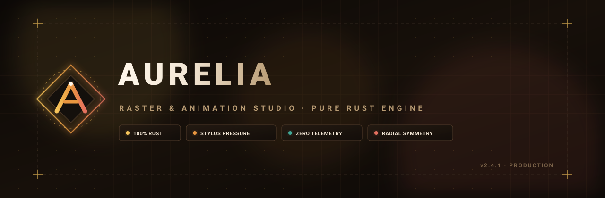

# Aurelia · Illustration & Animation Studio

<div align="center">



**A modern, high-performance, local-first digital illustration and animation studio built in Rust with a thin Win32 FFI layer.**

<br />

<!-- Tier 1: Project Metadata & Quality Assurance Badges -->
<p align="center">
  <a href="https://github.com/LeTrollologist/Aurelia/releases">
    
  </a>
  <a href="crates/">
    
  </a>
  <a href="crates/aurelia-render/">
    
  </a>
  <a href="PRIVACY.md">
    
  </a>
  <a href="crates/aurelia-io/">
    
  </a>
  <a href="LICENSE.md">
    
  </a>
  <a href="crates/aurelia-core/src/tests.rs">
    
  </a>
</p>

<!-- Tier 2: Runtime Target & Delivery Stack -->
<p align="center">
  
  &nbsp;
  
  &nbsp;
  
</p>

<p align="center">
  <a href="Cargo.toml">
    
  </a>
  &nbsp;
  <a href="https://github.com/LeTrollologist/Aurelia/releases">
    
  </a>
  &nbsp;
  <a href="RELEASE_PROCESS.md">
    
  </a>
  &nbsp;
  <a href="SECURITY.md">
    
  </a>
</p>

<!-- Tier 3: Interactive Quick Navigation Buttons -->
<p align="center">
  <a href="#-installation--getting-started">
    
  </a>
  &nbsp;
  <a href="#key-highlights">
    
  </a>
  &nbsp;
  <a href="#%EF%B8%8F-keyboard-shortcuts--controls">
    
  </a>
  &nbsp;
  <a href="ROADMAP.md">
    
  </a>
    <a href="https://github.com/LeTrollologist/Aurelia/wiki">
    
  </a>
  <a href="https://discord.gg/QujPkvhbhc">
    
  </a>
</p>

</div>

---

## 🌟 Overview

**Aurelia** is a lightweight, studio-grade digital illustration and raster graphics workbench engineered from the ground up in Rust. Designed for artists, concept designers, and technical illustrators who demand absolute precision, low latency, and deterministic offline reliability.

### Key Highlights

- **Layer Raster Masks**: per-layer 8-bit masks created from the selection, with invert /
  enable / remove and persisted in AUR v2/v3. Non-destructive - a mask only scales alpha while
  compositing, and a masked 4-layer 1080p composite still runs at 92 MPix/s.
- **Tilt-Aware Strokes**: `WM_POINTER` tilt now widens freehand strokes (0 = off), so laying
  the pen flatter behaves like a real brush instead of a constant-width line.
- **Measured Performance**: `cargo run --release -p aurelia-render --example bench_composite`
  reports composite throughput (113 MPix/s plain, 92 MPix/s masked here) against targets in
  ROADMAP.md.
 
- 🖥 **Windows-Native Architecture (Win32 + GDI, thin FFI)**: A hand-rolled `GetMessageW` message loop and `SetDIBitsToDevice` blit feed a software framebuffer; `egui` 0.28 supplies widgets and layout on top. No C++ UI framework and no GPU driver dependency.
  - **Safety boundary**: application logic and the renderer are safe Rust. The Win32/GDI/COM calls in `aurelia-app` and `rfd` are `unsafe` FFI, and the official Windows build links the MSVC C runtime; those layers are outside Rust's memory-safety guarantees. See [`docs/SECURITY_MODEL.md`](docs/SECURITY_MODEL.md).
  - **Per-Monitor V2 DPI Awareness**: `SetProcessDpiAwarenessContext` plus `egui` pixels-per-point, so the interface is crisp at 125–200 % scaling instead of bitmap-stretched.
  - **Portability-Ready Crate Split**: Windowing lives only in `aurelia-app`; `aurelia-core`, `aurelia-render`, `aurelia-io`, `aurelia-presence` and `aurelia-ui` are platform-agnostic, so the `eframe`/`winit` port in `ROADMAP.md` is a front-end swap rather than a rewrite.
- 🎨 **Live Interactive Viewport with Real-Time Direct Drawing**:
  - **Direct Viewport Interaction**: Drawing, brushing, and erasing happen directly on the canvas, which is composited and drawn by the CPU software renderer (`aurelia-render`) into the window framebuffer every frame, with the `egui` panels rasterised on top. All view geometry (`pan`, `zoom`, viewport clip) is in physical pixels; `egui` layout and pointer input are converted to and from points at the `pixels_per_point` boundary.
  - **Live Navigator Thumbnail**: The Navigator shows a downscaled copy of the same composite (`SoftwareRenderer::navigator_thumbnail`) as an `egui` texture, so it follows your strokes without a second full-document composite.
  - **Dynamic Viewport Rulers & Overlays**: Real-time pixel rulers with tracking cursor ticks, configurable canvas grid with a movable origin, draggable horizontal/vertical measurement guides, Move-tool Selected/Full modes, guide and layer snapping, and symmetry guide axes.
  - **Perspective Snapping Engine (<kbd>Ctrl+Shift+P</kbd>)**: 1, 2, and 3-point vanishing point rays and constraint projection.
- ⛶ **Free Transform & Mesh Warp (<kbd>Ctrl+T</kbd>)**: Studio-grade non-destructive pixel deformation supporting 4 operational modes:
  - **Affine 2D**: Scale, rotate, skew, translate, flip, custom pivot with interactive bounding box and rotation stalk.
  - **Perspective Quad**: 4-corner homography warping with analytical direct linear transformation (DLT) matrix inversion for true 3D planar alignment.
  - **Bicubic Mesh Grid**: Configurable $N \times M$ control grids (3x3, 4x4, 5x5, 6x6, 8x8) with draggable vertex pins and inverse bilinear quad mapping.
  - **Thin Plate Splines (TPS)**: Multi-pin landmark warping driven by radial basis function kernels with Gauss-Jordan partial pivoting solvers for organic elasticity.
  - **Subpixel Sampling Filters**: Real-time Bicubic (16-sample Catmull-Rom), Bilinear, and Nearest-neighbor interpolation.
- 🎨 **Native 16-bit sRGB Editing**: Create, open and save RGBA16 documents and edit them at their own storage width — painting, erasing, fill, gradients, shapes, text, free transform, filters, selection edits, compositing and merge-visible all run natively at 16 bits. The viewport still presents an 8-bit image because `egui` textures are 8-bit; that is a display limitation, not a data one.
- ✨ **Non-Destructive Adjustment Layers**: Real-time, zero-allocation filter passes during composite steps (`Brightness/Contrast`, `HSL`, `Color Balance`, `Invert`, `Posterize`, `Threshold`, `Sepia`) that dynamically affect layers underneath without altering base pixel data.
- 🎨 **Floating Mixing Scratchpad (<kbd>F4</kbd>)**: Persistent off-canvas color mixing dock for scribbling, smudging pigments, and eyedropper sampling without modifying the main document or history.
- ⚡ **Subpixel-Antialiased High-Frequency Engine**: Guaranteed physical sub-pixel antialiasing transition bands across all hardness levels, with true Catmull-Rom spline tangent curvature and S-Level Global Stroke Stabilization (S-0 through S-7 Lazy Rope).
- 📁 **Nested Layer Groups (Folders)**: Hierarchical folder management with collapsible trees, ancestor visibility/opacity inheritance, and one-click group duplication/ungrouping.
- 🖌️ **Selection Brush & Eraser**: Direct 8-bit alpha mask painting and erasing with brush dynamics, hardness falloff, and live ruby quick-mask overlay.
- 🎨 **Modern Studio Toolset**: Brush, Pencil, Watercolor (wet edge/falloff simulation), Chalk (grain dispersion), Spray (stochastic scatter), Smudge (directional velocity smear), Linear & Radial Gradients, Magic Wand fuzzy selection, Eraser modes (Soft, Hard 1-Bit, Color-Target), Dual-Color Vector Shapes, and Reference-layer Flood Fill.
- 🔤 **Custom Typography & Text Engine**: Text layers rendered through `ab_glyph` with the full system font list plus direct `.ttf`/`.otf` file import, real-time font size, line spacing and letter tracking, Left/Center/Right alignment, subpixel-antialiased rasterization, and on-canvas placement/editing with per-edit undo snapshots.
- 🧅 **Frame Animation Timeline**: Multi-frame timeline with play/pause preview, adjustable FPS and loop playback, frame add/duplicate/delete/reorder, ghost onion skinning (configurable previous/next frame counts and opacity), and <kbd>[</kbd> / <kbd>]</kbd> frame stepping.
- 🪟 **Windows Shell Integration & Drag-and-Drop**: Registers "Open with Aurelia" in the Explorer context menu for `.png`, `.jpg`, `.jpeg`, `.gif`, `.webp`, `.bmp`, `.ico`, `.tga`, `.tiff` and `.aur`, with one-click register/unregister from *File → Windows Context Menu Integration…* or the `--register-shell` / `--unregister-shell` CLI flags, plus native `WM_DROPFILES` drag-and-drop file opening.
- 🔒 **Layer Alpha Lock & Clipping Masks**: Protect layer transparency (`Alpha Lock`) or clip layers directly to underlying art bounds (`Clipping Mask`).
- 👁 **Zen / Full Canvas Mode**: Toggle all UI docks and toolbars with <kbd>Tab</kbd> for pure, distraction-free illustration with floating restore controls.
- ✦ **New Canvas Studio**: Pre-loaded potentials (1K/2K/4K Square, 1080p/4K Displays, A4/A5 Print @ 300 DPI, Social Media Banners, Pixel Art) and custom dimensions with aspect-ratio locking.
- 📐 **Symmetry & Grid Overlays**: Real-time Horizontal, Vertical, Quad, and multi-segment Radial/Mandala symmetry, with toggleable pixel grids (8px–128px) and dynamic viewport rulers.
- 💡 **Reference Viewer & Tracing Paper**: Floating `🖼` reference dock (detached window or on-canvas tracing mode) with zoom/pan, <kbd>T</kbd> tracing-paper toggle, and Dark / Pure-White Lightbox / Checkerboard backlight modes.
- 🪞 **View Flip & Fresh-Eye Review**: Horizontal viewport flip (<kbd>H</kbd>) — composition-only, never touches pixel data — for catching asymmetry while painting.
- 🛡️ **Zero-Allocation Rendering**: Highly optimized software rendering pipeline with reusable composite buffers for silky smooth 60+ FPS viewport navigation and drawing.
- 💾 **Crash-Proof Save Pipeline**: Unsaved-changes guard on close (`Save` / `Discard` / `Cancel`), quick-save to the known path (<kbd>Ctrl</kbd>+<kbd>S</kbd>), Save As (<kbd>Ctrl</kbd>+<kbd>Shift</kbd>+<kbd>S</kbd>), atomic temp-file-then-rename writes, recent-project menu, and an autosave recovery snapshot (default every 120 s) that is offered back on the next launch.
- ✍ **Stylus Pressure & Tilt**: Pen input is sampled through `WM_POINTER` / `GetPointerPenInfo`; real pressure drives brush size while the mouse path (and velocity dynamics) keeps working unchanged.
- 🧠 **Memory-Bounded Undo**: The 50-step history also enforces a 512 MiB budget, evicting the oldest full-layer snapshots first so long sessions cannot balloon into multi-gigabyte RSS.
- 📊 **Tone & Stylize Filters**: Levels (black/white/gamma), Colorize, Pixelate and Motion Blur alongside the existing blur/sharpen/grain/vignette/lens set — all with live, non-destructive previews and selection awareness.
- 🔒 **Local-First & Chain of Trust**: Completely offline, zero telemetry, no trackers, and local project serialization via binary compressed archives (`.aur`, AUR v3) alongside SHA-256-verified, VirusTotal-scanned installer and portable releases.

---

## 🏗️ Architecture

The workspace is organized into modular, decoupled Rust crates:

```text
Aurelia/
├── assets/           # Application icons (SVG, ICO, PNG) and banner art
├── crates/
│   ├── aurelia-core/  # Core domain models, perspective geometry, affine/quad/mesh/TPS deformation, adjustment filters, layers, and rasterizers
│   ├── aurelia-render/ # Software renderer, perspective guides, texture caching, grid/ruler overlays, and UI primitives
│   ├── aurelia-io/    # Binary AUR v3 project serialization, image export, and file parsing
│   ├── aurelia-ui/    # Modern egui-based dock panels, studio viewport, tools shelf, transform studio, perspective dock, and palettes
│   ├── aurelia-presence/ # Optional Discord Rich Presence over local IPC
│   └── aurelia-app/   # Win32 + GDI host: message loop, stylus sampling, autosave ticker, CLI
```

## Compatibility at a glance

| Area | Supported | Limits |
| :--- | :--- | :--- |
| OS | Windows 10/11 x86-64 | No Linux/macOS build yet |
| Project files | AUR v3 (`.aur`), legacy HCV v2–v5 (`.hcv`) | AUR v1/v2 are read-only compatibility formats; saves always write v3 |
| Pixel formats | 8-bit and 16-bit sRGB documents; native 16-bit editing and compositing | Viewport presents an 8-bit image; mixed-format documents round-trip but are not created by the editor |
| Layer features | Raster, groups, masks, adjustment layers, text, clipping | Animation is timeline-only; no video export |
| Exports | PNG, JPEG, WebP, GIF, sprite sheets, frame sequences | Color profiles are not embedded yet; no ICC/Display P3 workflow |
| Rich Presence | Optional Discord IPC | Off by default; no artwork previews; Windows Discord desktop only |
| Distribution | Portable zip + per-user Inno installer | Installer is unsigned; artifacts are Ed25519-signed |

Authoritative details: [`docs/COMPATIBILITY.md`](docs/COMPATIBILITY.md) and [`docs/PROJECT_FORMAT.md`](docs/PROJECT_FORMAT.md).

---

## 🚀 Installation & Getting Started

Aurelia ships as a **per-user Windows installer**, a portable zip, or a pure-Rust source build.
Full details, silent-install switches and verification steps live in [`INSTALL.md`](INSTALL.md).

### Option 1: Installer (Recommended)

1. Download [`Aurelia-Setup-3.4.1.exe`](https://github.com/LeTrollologist/Aurelia/releases/latest) from the latest release.
2. Run it — it installs per user to `%LOCALAPPDATA%\Programs\Aurelia` (no administrator rights, no UAC prompt).
3. Optionally keep *"Open Aurelia projects with Aurelia (.aur, .hcv)"* checked for double-click opening, and tick *Create a desktop shortcut*.
4. Launch **Aurelia** from the Start menu.

Silent install:

```powershell
Aurelia-Setup-3.4.1.exe /VERYSILENT /SUPPRESSMSGBOXES /NORESTART
```

---

### Option 2: Portable Zip

No installer and no registry writes of its own:

1. Download [`Aurelia-v3.4.1-win64.zip`](https://github.com/LeTrollologist/Aurelia/releases/latest) from the latest release.
2. Extract it with PowerShell or Windows Explorer:
   ```powershell
   Expand-Archive -Path .\Aurelia-v3.4.1-win64.zip -DestinationPath .\Aurelia
   ```
3. Double-click `Aurelia\aurelia.exe` to launch immediately.

Both distributions keep settings in `%LOCALAPPDATA%\Aurelia` (theme, recent projects, autosave),
and every release publishes a `SHA256SUMS.txt` for verification.

### Verifying a download

Each release publishes `SHA256SUMS.txt`, a detached `.sig` for it and for every binary, and
`aurelia-publisher-2026.pub`. The `.sig` files are raw 64-byte Ed25519 signatures — not hashes.

```powershell
Get-FileHash .\Aurelia-v3.4.1-win64.zip -Algorithm SHA256
Get-Content .\SHA256SUMS.txt        # compare the digest
```

Verify the signature with Python and the included public key:

```python
from pathlib import Path
from cryptography.hazmat.primitives.asymmetric.ed25519 import Ed25519PublicKey

pub = Ed25519PublicKey.from_public_bytes(bytes.fromhex(Path("aurelia-publisher-2026.pub").read_text().strip()))
for name in ("Aurelia-v3.4.1-win64.zip", "Aurelia-Setup-3.4.1.exe", "SHA256SUMS.txt"):
    pub.verify(Path(name + ".sig").read_bytes(), Path(name).read_bytes())
print("signatures verified")
```

The installer is **not Authenticode-signed**, so Windows SmartScreen may still warn. VirusTotal
results are advisory: unsigned software often trips heuristic/ML engines. A clean scan is not a
proof of safety; a matching Ed25519 signature is the integrity boundary. See
[`docs/SECURITY_MODEL.md`](docs/SECURITY_MODEL.md).

---

### Option 3: Compile from Source (Rust + Win32 FFI)

If you prefer building from source with full compiler optimizations:

**Prerequisites:**
- [Rust Toolchain](https://www.rust-lang.org/tools/install) — 1.80+ recommended (this release was built and verified with `rustc 1.98.0`)
- **Windows 10 / 11 (64-bit)** — the host layer is Win32 + GDI, so there is no Linux/macOS build yet (tracked in [`ROADMAP.md`](ROADMAP.md))

1. Clone the repository:
   ```bash
   git clone https://github.com/LeTrollologist/Aurelia.git
   cd Aurelia
   ```

2. Run the test suite:
   ```bash
   cargo test --workspace
   ```

3. Build and launch:
   ```bash
   cargo run --release -p aurelia-app
   ```

---

## ⌨️ Keyboard Shortcuts & Controls

### Tools

| Action | Shortcut |
| :--- | :--- |
| **Brush** | <kbd>B</kbd> |
| **Pencil** | <kbd>P</kbd> |
| **Eraser** | <kbd>E</kbd> |
| **Magic Wand (fuzzy select)** | <kbd>W</kbd> |
| **Gradient** | <kbd>G</kbd> |
| **Marquee Select** | <kbd>M</kbd> |
| **Lasso Select** | <kbd>L</kbd> |
| **Selection Brush** | <kbd>Q</kbd> |
| **Selection Eraser** | <kbd>Shift</kbd> + <kbd>Q</kbd> |
| **Move Layer** | <kbd>V</kbd> |
| **Free Transform Studio** | <kbd>Ctrl</kbd> + <kbd>T</kbd> |
| **Eyedropper (Pick Color)** | <kbd>I</kbd> or <kbd>Alt</kbd> + Click |
| **Swap Primary/Secondary Color** | <kbd>X</kbd> |

### Viewport & Canvas

| Action | Shortcut |
| :--- | :--- |
| **Viewport Pan** | <kbd>Space</kbd> + Drag or Middle-Mouse Drag |
| **Viewport Zoom** | <kbd>Mouse Wheel</kbd> |
| **Fit to Screen** | <kbd>Ctrl</kbd> + <kbd>0</kbd> |
| **Actual Size (100%)** | <kbd>Ctrl</kbd> + <kbd>1</kbd> |
| **Zen / Full Canvas Mode** | <kbd>Tab</kbd> |
| **Flip View Horizontally** | <kbd>H</kbd> |
| **Toggle Canvas Grid** | <kbd>Ctrl</kbd> + <kbd>'</kbd> |
| **Toggle Canvas Rulers** | <kbd>Ctrl</kbd> + <kbd>R</kbd> |
| **Toggle Tracing Paper** | <kbd>T</kbd> |
| **Toggle Perspective Snapping** | <kbd>Ctrl</kbd> + <kbd>Shift</kbd> + <kbd>P</kbd> |
| **Mixing Scratchpad Dock** | <kbd>F4</kbd> |
| **Perspective Studio Dock** | <kbd>F5</kbd> |

### Animation Timeline

| Action | Shortcut |
| :--- | :--- |
| **Toggle Onion Skinning** | <kbd>O</kbd> |
| **Previous / Next Frame** | <kbd>[</kbd> / <kbd>]</kbd> |

### Document & Selection

| Action | Shortcut |
| :--- | :--- |
| **New Canvas** | <kbd>Ctrl</kbd> + <kbd>N</kbd> |
| **Open Project / Image** | <kbd>Ctrl</kbd> + <kbd>O</kbd> |
| **Save Project** | <kbd>Ctrl</kbd> + <kbd>S</kbd> |
| **Save Project As** | <kbd>Ctrl</kbd> + <kbd>Shift</kbd> + <kbd>S</kbd> |
| **Export Image (PNG / JPEG / WebP)** | <kbd>Ctrl</kbd> + <kbd>E</kbd> |
| **Select All** | <kbd>Ctrl</kbd> + <kbd>A</kbd> |
| **Deselect** | <kbd>Ctrl</kbd> + <kbd>D</kbd> or <kbd>Esc</kbd> |
| **Fill Selection (active layer)** | <kbd>Shift</kbd> + <kbd>F5</kbd> or <kbd>Alt</kbd> + <kbd>Backspace</kbd> |
| **Invert Colors** | <kbd>Ctrl</kbd> + <kbd>I</kbd> |
| **Commit Polygon / Crop / Transform** | <kbd>Enter</kbd> |
| **Cancel Polygon / Crop / Transform** | <kbd>Esc</kbd> |
| **Undo** | <kbd>Ctrl</kbd> + <kbd>Z</kbd> |
| **Redo** | <kbd>Ctrl</kbd> + <kbd>Y</kbd> or <kbd>Ctrl</kbd> + <kbd>Shift</kbd> + <kbd>Z</kbd> |

> Global hotkeys are suspended while a text box is being edited, so <kbd>B</kbd>, <kbd>T</kbd>, <kbd>Q</kbd>, … type normal characters instead of switching tools.

---

## 🖥️ Command-Line Interface

The packaged binary (`aurelia.exe`; `aurelia-app.exe` when built with Cargo) also exposes a headless CLI:

| Command | Description |
| :--- | :--- |
| `aurelia.exe [FILE]` | Launch the studio, optionally opening an image or `.aur` project immediately |
| `aurelia.exe --register-shell` | Register **Open with Aurelia** in the Windows Explorer context menu |
| `aurelia.exe --unregister-shell` | Remove the Explorer context-menu association |
| `aurelia.exe export <INPUT> -o <OUTPUT> [--format png\|jpg\|webp]` | Flatten a project/image to a single image without starting the UI |
| `aurelia.exe inspect <INPUT>` | Print canvas size, active layer, theme, and the full layer stack |
| `aurelia.exe --help` | Print the CLI usage summary |

---

## 🤝 Contributing

Contributions are welcome! Please feel free to submit issues, feature requests, or pull requests.

1. Fork the repository
2. Create your feature branch (`git checkout -b feature/amazing-feature`)
3. Commit your changes (`git commit -m 'Add amazing feature'`)
4. Push to the branch (`git push origin feature/amazing-feature`)
5. Open a Pull Request

### Local verification and releases (no GitHub Actions)

There is no CI workflow by design. Releases are cut locally with the journal-backed
orchestrator in [`tools/release`](tools/release), not `scripts/pipeline.py`:

```powershell
cargo test --workspace

$env:PYTHONPATH = "tools/release"
python -m aurelia_release --repo . plan v3.4.1   # read-only preview
python -m aurelia_release --repo . run  v3.4.1   # build, test, package, sign, tag, publish
```

The `full` profile requires a `release.toml` with build/package commands, a GitHub token, and
the private signing key. See [`RELEASE_PROCESS.md`](RELEASE_PROCESS.md) and
[`tools/release/README.md`](tools/release/README.md).

---

## 📄 License

This project is licensed under the terms of the **GNU General Public License v3.0** (GPL-3.0). See [LICENSE.md](LICENSE.md) for details.

---

<div align="center">
  <sub>Crafted with passion by <a href="https://github.com/LeTrollologist">LeTrollologist</a>.</sub>
</div>
